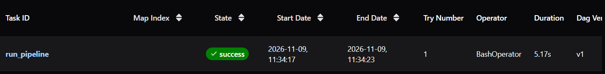

# Weather ETL Pipeline

A small ETL pipeline that pulls hourly weather data from the [Open-Meteo](https://open-meteo.com/) API for four Pakistani cities, validates it, and loads it into a Dockerized PostgreSQL database.

**Cities:** Karachi, Lahore, Islamabad, Peshawar

## How it works

```
Open-Meteo API -> extract -> transform + validate -> upsert into Postgres
```

- **Extract:** fetches hourly temperature, humidity, wind speed, precipitation and weather code per city.
- **Transform:** cleans the data with pandas and runs a bad-rows check before loading.
- **Load:** upserts into `hourly_weather` using `ON CONFLICT (city, observed_at) DO UPDATE`, so the pipeline is idempotent. Re-running it never creates duplicates, and revised values overwrite old ones.

## Stack

Python, pandas, PostgreSQL 16, Docker Compose, psycopg2

## Setup

```bash
# 0. Create your config file and edit the values
    cp .env.example .env
# 1. Start Postgres
docker compose up -d

# 2. Create a virtual environment and install dependencies
python3 -m venv venv
source venv/bin/activate
pip install pandas requests psycopg2-binary

# 3. Create the table (first run only)
docker compose exec db psql -U pipeline -d weather -c "
CREATE TABLE IF NOT EXISTS hourly_weather (
    city                 TEXT      NOT NULL,
    observed_at          TIMESTAMP NOT NULL,
    temperature_2m       REAL,
    relative_humidity_2m INTEGER,
    wind_speed_10m       REAL,
    precipitation        REAL,
    weather_code         INTEGER,
    PRIMARY KEY (city, observed_at)
);"
```

## Usage

```bash
# Load the latest data
python pipeline.py daily

# Load a historical range
python pipeline.py backfill 2024-09-11 2026-10-11
```

## Check the data

```bash
docker compose exec db psql -U pipeline -d weather \
  -c "SELECT city, count(*), min(observed_at), max(observed_at) FROM hourly_weather GROUP BY city;"
```

## Scheduling with Airflow

The daily load is scheduled with Apache Airflow. The DAG in `dags/weather_daily.py` runs `pipeline.py daily` once a day. Because the load is an upsert, retries and re-runs are safe.

Airflow runs in its own virtual environment (Python 3.12), separate from the pipeline's, so their dependencies don't clash. The DAG calls the pipeline's own Python, so Airflow doesn't need pandas.

```bash
# One-time setup
uv venv --python 3.12 ~/venvs/airflow
source ~/venvs/airflow/bin/activate
uv pip install "apache-airflow==3.0.6" \
  --constraint "https://raw.githubusercontent.com/apache/airflow/constraints-3.0.6/constraints-3.12.txt"

# Each time you start it
export AIRFLOW_HOME=~/airflow
export AIRFLOW__CORE__DAGS_FOLDER=~/projects/etl-pipeline/dags
airflow standalone
```

Then open http://localhost:8080 and log in with the credentials printed in the terminal. The `weather_daily` DAG appears in the list, and you can run it once with **Trigger**.

Postgres must be running (`docker compose up -d`) for the load to succeed.


## Transforming with dbt

A dbt project in `dbt_weather/` turns the raw hourly table into an analysis-ready model, `analytics.daily_weather`: one row per city per day with average, max and min temperature and total rain.

Data tests check that `city`, `day` and `avg_temp` are never null.

```bash
# One-time setup
uv venv --python 3.12 ~/venvs/dbt
source ~/venvs/dbt/bin/activate
uv pip install dbt-postgres
```

dbt reads its database connection from `~/.dbt/profiles.yml`, which is kept outside the repo so credentials aren't committed. Add a profile named `dbt_weather` pointing at the local Postgres (host `localhost`, port `5432`, database `weather`, schema `analytics`), or generate it with `dbt init`.

```bash
# Build and test the model
cd dbt_weather
dbt run
dbt test
```

Run `dbt run` after each load to refresh the daily summary.

## Roadmap

- [X] Schedule the daily run with Apache Airflow
- [X] Add dbt models (daily aggregates per city) with data tests
- [X] Move credentials to environment variables
